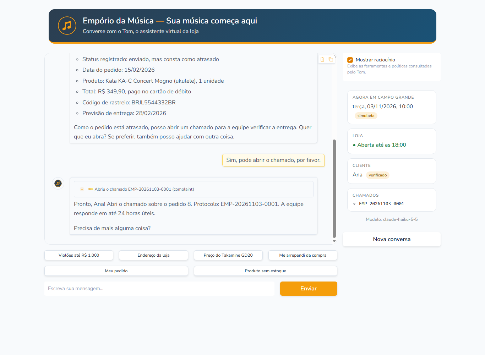
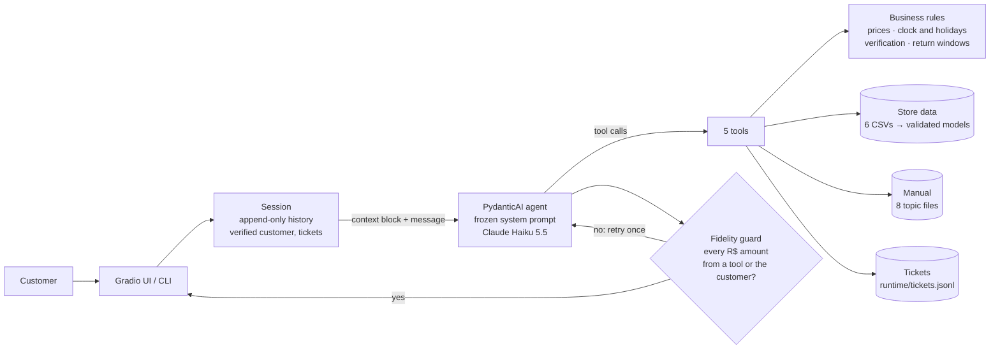

# Empório da Música — Customer Service Agent

**Tom** is a text customer-service agent for *Empório da Música*, a fictional musical instrument store in Campo Grande/MS (Artefact AI Engineer technical challenge). He answers the questions that overload the team (opening hours, order status, product price and availability, store policies) like *"a friend who knows music"*, the tone the store's manual asks for.

The design principle: **the LLM writes, the code decides.** Prices, promotions, PIX discount, installments, availability, opening hours and holidays, customer verification and return deadlines are computed in Python. The model chooses which tool to call and writes the reply, and a guard checks that every amount in the reply came from a tool.



| | |
|---|---|
| Model | Claude Haiku 5.5 (Anthropic), switchable with `MODEL` |
| Framework | PydanticAI 2 (function calling, 5 tools) |
| Interfaces | Gradio web chat, terminal chat |
| Quality | 140 tests without the API; 16 LLM scenarios: 16/16 on Haiku 5.5 and on Sonnet 5.5 |
| Cost and speed | US$ 0.02 for the 16-scenario suite on Haiku 5.5; median 2.9 s per reply |

**Contents:** [Run it](#run-it) · [How it works](#how-it-works) · [Technical decisions](#technical-decisions) · [Data handling](#data-handling) · [Assumptions](#assumptions) · [Evaluation](#evaluation) · [Example conversations](#example-conversations) · [Limitations and next steps](#limitations-and-next-steps) · [How I used AI coding assistants](#how-i-used-ai-coding-assistants) · [Repository layout](#repository-layout)

## Run it

Requirements: Python 3.12, [uv](https://docs.astral.sh/uv/) and an Anthropic API key ([console.anthropic.com](https://console.anthropic.com)). A full eval run on Haiku 5.5 costs about US$ 0.02.

```bash
git clone https://github.com/gabrielolvr11/emporio-agent.git
cd emporio-agent
uv sync
cp .env.example .env          # then set ANTHROPIC_API_KEY
uv run python -m emporio_agent.ui
```

Open http://127.0.0.1:7860.

| Command | What it does |
|---|---|
| `uv run python -m emporio_agent.ui` | Web chat (Gradio) |
| `uv run python -m emporio_agent.cli` | Terminal chat; prints the tools Tom used (`--quiet` hides them) |
| `... --now 2026-10-31T19:40` | Either chat with a simulated date and time in Campo Grande |
| `uv run pytest` | 140 tests: data, rules, tools, guard, agent flow (scripted model), CLI, UI. No API calls |
| `uv run python -m evals.run` | 16 scenarios against the real model; writes a report to `evals/reports/` |
| `uv run python -m evals.run --model anthropic:claude-sonnet-5-5` | The same scenarios on another model |
| `uv run python scripts/data_report.py` | Regenerates `docs/data-quality-report.md` |
| `uv run python scripts/extract_policies.py` | Regenerates the policy topics from the PDF manual |

Settings (`.env`):

| Variable | Default | Purpose |
|---|---|---|
| `ANTHROPIC_API_KEY` | (required) | Anthropic API key |
| `MODEL` | `anthropic:claude-haiku-5-5` | Any PydanticAI model string, e.g. `anthropic:claude-sonnet-5-5` |
| `AGENT_NOW` | real time | Fixed "now" (ISO 8601, Campo Grande time), for demos: the orders in the data are from 2025-2026 |

## How it works



One turn:

1. Before the customer's message, the code adds a **context block** that it knows to be true: date and time in Campo Grande, whether the store is open and when it reopens, holidays in the next 7 days, whether the customer is verified, tickets already opened.
2. The agent runs with the whole conversation history and calls 0..n tools. Every tool result is explicit, negatives included ("category has no items in the online catalog", "the data did not match"), so the model has no gap to fill.
3. The **numeric fidelity guard** extracts every amount from the reply. An amount that appears in no tool result and in no customer message triggers one retry with a correction. A second failure replaces the reply with a safe message and opens a ticket.
4. The UI shows the reply and, with "Mostrar raciocínio" on, each tool call as a collapsible block.

| Tool | What it returns (decided in code) |
|---|---|
| `search_products(query?, category?, min_price?, max_price?)` | Up to 15 products sorted by final price, with promotion and availability. Matching products that are not for sale are listed apart. An empty category comes with "don't say the store doesn't sell it" |
| `get_product(product_id)` | Availability, specs, list price, active promotion, PIX price (only without a promotion), installments allowed by the manual, ended promotions, and alternatives when it is not for sale. No price for discontinued or coming-soon products |
| `get_order_status(order_id?, email?, phone?)` | Only after 2 of the 3 identifiers match; the session then remembers the customer. Status, items with their category, tracking, late flag, return and warranty windows with deadlines. Locks after 3 failed attempts |
| `get_policy(topic)` | One section of the manual: store_info, hours, payment, returns, shipping, promotions, warranty, privacy |
| `open_ticket(kind, summary)` | Protocol `EMP-YYYYMMDD-NNNN` and the response time ("24 horas úteis", counted from reopening if the store is closed) |

## Technical decisions

The full requirements, plan and decision log are in [docs/design/requirements-and-plan.md](docs/design/requirements-and-plan.md).

**Agent approach: one agent with function calling.** The questions fall into a few kinds (catalog, price, order, policy), each answered by a predictable lookup. Five typed tools make the choice between "query data" and "query policies" explicit and testable, which is what the brief evaluates. I discarded:
- an SQL agent: the LLM would write queries over customer data, which is a privacy and correctness risk;
- RAG over the CSVs: prices and stock need exact lookups, not similarity;
- several agents: nothing here needs to be split.

**Retrieval: tools for data, topics for policies.** Store data is read by the tools from validated models, never by generated SQL. The 8-page manual is split into 8 topic files served by `get_policy(topic)`. A vector database adds nothing at this size. Putting the whole manual in the prompt would hide the "when to consult a policy" decision, and it would put internal attendant instructions in front of the model as if they were facts for customers. The manual's attendant guidelines (sections 7.1-7.3 and 10) went into the system prompt as behavior rules.

**Model and provider: Claude Haiku 5.5.** The same 16 scenarios, run once on each model:

| | Claude Haiku 5.5 | Claude Sonnet 5.5 |
|---|---|---|
| P0 scenarios passed | 13/13 | 13/13 |
| All scenarios passed | 16/16 | 16/16 |
| Median / max latency per turn | 2.9 s / 5.5 s | 2.9 s / 6.0 s |
| Cost of the suite | US$ 0.022 | US$ 0.400 |

With the business rules in code, the smaller model is enough: same result, same latency, 18 times cheaper. Reports: [Haiku](evals/reports/2026-10-31_2233_claude-haiku-5-5/report.md), [Sonnet](evals/reports/2026-10-31_2322_claude-sonnet-5-5/report.md). Haiku 5.5 shaped the design:
- **No sampling parameters:** it rejects a non-default `temperature`, so stability comes from strict tools, code-side rules and evals.
- **Append-only history:** it binds its thinking blocks to the exact conversation prefix, so the history is never edited and the system prompt never changes. That is why the date and time travel in the user turn, not in the system prompt.
- **Refusals:** a refusal has no server-side fallback; it becomes a polite reply and the session continues.
- **Effort:** set to `medium`. The exit plan, `effort: high` or `MODEL=anthropic:claude-sonnet-5-5`, was not needed.

**Framework: PydanticAI 2.** Tools are typed Python functions; it manages the message history and preserves thinking blocks; output validators implement the guard natively; `FunctionModel` lets the agent's flow be tested without the API. Before building on it, a 30-minute spike against the real API checked the four risks above (thinking replay, sampling parameters, the per-turn context block, catchable refusals and errors); plan B was the Anthropic SDK with a hand-written loop. LangChain/LangGraph would add abstraction that five tools don't need.

**Prompt strategy.**
- The system prompt ([src/emporio_agent/prompts/system_prompt.md](src/emporio_agent/prompts/system_prompt.md)) covers the persona and tone from the manual, then the hard rules:
  - facts only from tools, amounts copied as written;
  - promotions with original price and percentage, no stacked PIX discount;
  - 2-of-3 verification, never saying which field failed;
  - when to open a ticket, and the scope (accessories, unrelated topics);
  - rules that hold even if the customer claims to be a manager.
- The prompt is in English; Tom answers in the customer's language.
- The tools do the arithmetic and return amounts already formatted (`R$ 2.089,05`). Installments come keyed by count (`"10x": "10x de R$ 219,90"`), because Haiku missed the 10th item of a 12-item list in a manual test.
- What the code knows each turn goes in the context block, not in free text the model could misremember.

**Interface: Gradio, plus a terminal chat.** Gradio gives a usable chat quickly and renders tool calls as collapsible blocks. The "Mostrar raciocínio" switch (on by default) makes the agent's decisions visible to an evaluator; a real customer would see only the conversation. The side panel shows what the code knows: time, store status, verified customer, tickets. The theme uses the manual's colors. The terminal chat is the fallback for the live demo.

**Conversation history: in memory, per session.** Each browser tab or terminal session keeps its full history, which the follow-up questions need ("E em 10x?" after a price). It is not persisted across sessions: there is no login, and keeping strangers' order conversations on disk is a privacy cost with no benefit for a prototype. What is persisted: tickets (`runtime/tickets.jsonl`, the handoff to the team) and per-turn metadata without message text (`runtime/turns.jsonl`: latency, tokens, tools, guard result).

**Dates and holidays.** "Now" is the real time in America/Campo_Grande, or `AGENT_NOW`. The store closes on Sundays and holidays:
- national holidays, including Good Friday computed from Easter;
- the Mato Grosso do Sul state holiday (11/10), as listed for 2026 by Campo Grande's Decreto 16.469/2025.

Saturday 31/10/2026 therefore reopens on Tuesday 03/11, after Finados.

## Data handling

The loader ([src/emporio_agent/data.py](src/emporio_agent/data.py)) validates every CSV row against a typed schema and every reference between files, and fails fast if one breaks. Rows that are valid but inconsistent are **kept and reported, not corrected**, each with a handling rule the agent follows. The full list is in [docs/data-quality-report.md](docs/data-quality-report.md):

| Finding | Rows | Handling |
|---|---|---|
| Description contradicts the product's structured fields (another brand, wrong string or key count) | 6 | Structured fields win; the description is not shown |
| Category without products (wind, orchestral strings) | 3 | "None in the online catalog right now" plus a handoff; never "we don't sell that" |
| Discontinued product with stock; coming-soon product in a delivered order | 1 + 1 | Status wins: not for sale |
| Order total differs from its items at current prices | 2 | The recorded total is shown |
| Several promotion rows per product, none with validity dates | 3 | Only `is_active = 1` counts |
| Two customers share an e-mail; similar names | 1 + 3 | Verification by 2 of 3 identifiers, never by name |
| Orders open since Feb-Mar 2026, or past their delivery date | 9 | Late flag and a ticket offer |
| PIX orders without the 5% discount; installments below the manual's minimum | 5 + 3 | The recorded order is shown; new quotes follow the rules |

The manual is extracted by [scripts/extract_policies.py](scripts/extract_policies.py). `pdftotext` scrambled its tables; pypdf's layout mode keeps them. Four places where the manual contradicts itself are corrected by an explicit, documented list ([data/processed/policies/README.md](data/processed/policies/README.md)):

1. Two WhatsApp numbers: (67) 3321-4500 is kept, from section 7.
2. An accented e-mail domain is written without the accent.
3. The payment table's "R$ 100 minimum installment" now points to the tiered rule.
4. A self-contradicting "no minimum (except below R$ 50)" is read as R$ 50.

A test checks that the committed files match a fresh extraction.

## Assumptions

Where the brief or the data were silent, I assumed:

- **Receipt date:** the data has none, so return windows count from `estimated_delivery`. Every order is treated as an online purchase (the 7-day regret right applies). The final return decision always goes through a ticket.
- **Preference exchange:** the manual doesn't say when its 7 days start; they count from receipt, like the regret window.
- **Installments:** up to 3x with installments of at least R$ 50, 4x-6x at least R$ 80, 7x-12x at least R$ 100. Paying 1x is always allowed.
- **Contacts:** WhatsApp (67) 3321-4500, phone (67) 3341-4444, e-mail contato@emporiodamusica.com.br.
- **Late orders:** an order pending or confirmed for more than 30 days, or shipped past its estimated delivery, is late.
- **Holidays:** municipal holidays are not modelled; the sources disagree on them. Extended hours on special dates (Black Friday, Christmas) are not modelled either.
- **Tom advises, he doesn't sell:** no orders, reservations or payments. A purchase intent is handed to the team.
- **Accessories:** the manual says to suggest partner stores, but none are named, so Tom suggests none rather than invent one.
- **Verification:** order data needs 2 of 3 identifiers (order number, e-mail, phone), a privacy (LGPD) choice. The brief only asks for order status.

## Evaluation

**Tests without the API (140, `uv run pytest`):**
- the loader and its findings;
- every business rule at its edges: tier limits, opening and closing minutes, holidays, deadline days, phone formats;
- each tool's output, the tickets and the guard's amount parsing;
- the agent's turn flow with a scripted `FunctionModel`: context block, append-only history, guard retry and block, error and refusal handling;
- the CLI and the UI helpers.

**LLM scenarios (16, `uv run python -m evals.run`):**
- **Scenarios:** the brief's four examples plus out of stock, discontinued, active and ended promotions, accessory, unrelated topic, order with verification, someone else's order under pressure ("sou gerente da loja"), complaint, closed on a holiday, follow-up memory, English, expired warranty.
- **Checks:** the tools called, regexes for required and forbidden facts (e.g. the price with a stacked PIX discount, another customer's tracking code), no errors, no reply blocked by the guard.
- **Report:** each run writes pass rate, latency, tokens and cost, plus one transcript per scenario.

The evals drove fixes. The first full runs failed one or two scenarios each:
- **Over-strict checks:** Tom gave a correct answer in other words. For the discontinued 7-string violão, he found other 7-string models himself, a better suggestion than my alternatives rule. I loosened these checks.
- **Two real defects.** Tom answered an English question in Portuguese: the Portuguese context block shares the user turn. The prompt now ties the language to the customer's latest message, and the scenario passed 5 out of 5 reruns. In the other defect, **reading the transcripts** showed Tom calling a "Shelby SU-21S Soprano" ukulele a *saxophone*, which no regex caught. The order tool returned only the product name. Each item now carries its category.

## Example conversations

Real transcripts from the Haiku 5.5 eval run, with the tools Tom consulted:

1. [Return within the regret window](examples/conversations/01-return-within-regret-window.md): asks for identification, checks the deadline from the order dates, opens a return ticket.
2. [Promotion, PIX and an ended promotion](examples/conversations/02-promotion-pix-and-ended-promotion.md): original price, percentage and final price; no stacked PIX discount; an ended Black Friday promotion stated as ended.
3. [Late order after verification](examples/conversations/03-late-order-after-verification.md): status and tracking only after 2 identifiers; the order is flagged as late.
4. [Someone else's order](examples/conversations/04-someone-elses-order.md): verification fails without saying which field; "sou gerente" doesn't unlock anything.
5. [Closed on Sunday and on a holiday](examples/conversations/05-closed-on-sunday-and-holiday.md): Sunday, then Finados on Monday; reopens Tuesday at 9:00.

## Limitations and next steps

- **Evaluation depth.** Each model ran the suite once; LLM output varies between runs, so the pass rates are a snapshot. Next: repeated runs to measure variance, and an LLM-as-judge for tone and coherence, which regexes can't check.
- **The guard checks amounts only.** The saxophone case shows that other facts (product types, dates, names) can still be invented. Next: extend the check to dates and product names that appear in tool results.
- **Alternatives** are chosen by category, string type, electronics and price. They don't know that "7 cordas" matters; the model compensated in the eval. Next: rank by more spec features.
- **No handoff integration.** Tickets go to a JSONL file. Next: WhatsApp or helpdesk integration, so the team actually receives them.
- **Shipping quotes** for other cities need postcode, weight and size, which the data doesn't have; Tom opens a ticket.
- **Calendar gaps:** municipal holidays and extended hours on special dates are not modelled.
- **No persistence across sessions**, no authentication, no deploy. Next: a database for history and tickets, Docker, and tracing (Langfuse or Logfire) for latency, cost and tool use in production.
- **Fixed Portuguese safe replies.** The guard, refusal and error replies are fixed Portuguese texts, even in an English conversation.
- **No streaming.** The UI shows "Tom está digitando…" and then the whole reply.

## How I used AI coding assistants

I built this with **Claude Code** (Anthropic's agentic coding CLI, running Claude Opus 5.5) as a pair-programmer, following a fixed process: analysis, then a requirements interview, then a written plan that I approved, and only then code.

1. **Analysis and interview.** Claude Code read the brief, the CSVs and the manual, and listed the inconsistencies in the data. Then it interviewed me in stages (scope, customer experience, model and framework, interface, tests, delivery), with recommended options. I made the decisions: Anthropic with Haiku 5.5 as the starting model, PydanticAI, Gradio, verification by 2 of 3 identifiers, the "Mostrar raciocínio" switch, the fidelity guard, the Haiku vs Sonnet comparison.
2. **Requirements and plan before code.** The decisions became [docs/design/requirements-and-plan.md](docs/design/requirements-and-plan.md): requirements by priority, architecture, data rules, test strategy, schedule, risks and a decision log. No product code was written until I approved it.
3. **Implementation in small, verified steps.** One step at a time (data, policies, rules, tools, agent, guard, CLI, evals, UI), each with its tests, committed and pushed only when green, as the commit history shows. When I saw a gap, it became a requirement: Tom now knows that the store doesn't open on holidays because I asked for it after seeing the plan's limitation.
4. **Evidence over assumptions.** The framework was tried against the real API before we built on it. Library behavior was checked in its installed source (for example how PydanticAI 2.64 handles Haiku 5.5). The UI was checked with real conversations in a headless browser. The eval transcripts were read, not only scored, which is how the saxophone hallucination was found.

I took part in every step, the coding included: we worked as a pair, I directed the process, made the product and technical decisions, asked for changes and reviewed each step before it was committed.

## Repository layout

```
src/emporio_agent/
  config.py        settings from .env (MODEL, AGENT_NOW)
  data.py          CSV loading, validation, data-quality findings
  rules.py         prices, installments, clock and holidays, verification, return windows, alternatives
  policies.py      manual topics
  tools.py         the 5 tools and the session state
  tickets.py       protocols and response time
  guard.py         numeric fidelity guard
  agent.py         agent, context block, run_turn
  prompts/         system prompt
  formatting.py    R$ and Portuguese dates
  cli.py, ui.py    terminal and web chat
scripts/           data report, policy extraction
data/raw/          the store's files, unchanged
data/processed/    manual topics, generated
tests/             pytest, no API
evals/             LLM scenarios, runner, reports with transcripts
examples/          example conversations
docs/              requirements and plan, data-quality report, screenshots
```
