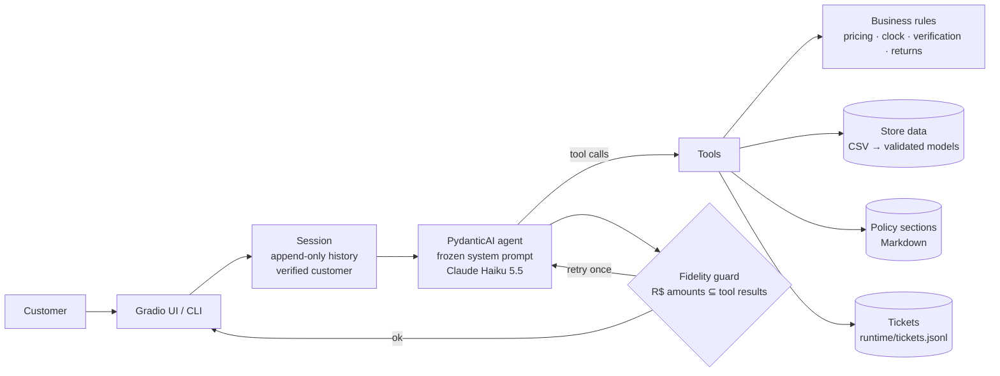
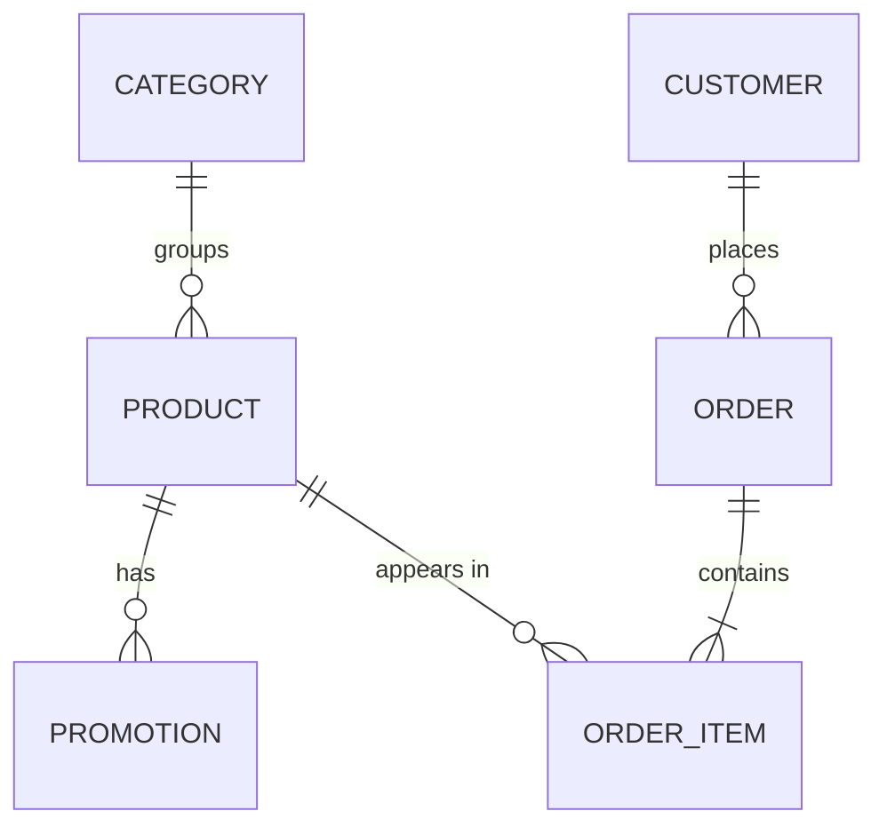

# Empório da Música Agent: Requirements and Development Plan

| | |
|---|---|
| Author | Gabriel Oliveira Souza (AI Engineer candidate), with Claude Code |
| Status | **Approved on 2026-10-31.** Implementation follows §10 |
| Date | 2026-10-31 |
| Deadline | **Wednesday 2026-11-04, 23:59** (America/Campo_Grande). Nothing changes in the repository after that |
| Budget | About 5 h/day, about 21 h in total, including a margin |

This document combines the requirements and the plan. It records the decisions from the requirements interview (stages A to H, see the [decision log](#appendix-a-decision-log)), so implementation does not reopen them.

---

## 1. Solution overview

**Goal.** A Python text agent, **Tom**, that answers Empório da Música customers. It handles the questions that overload the team: opening hours, order status, product price and availability, and store policies.

**Value proposition.** Tom answers like *"a friend who knows music"* (manual §7.1). It never invents a price, a stock level or a deadline. Anything with a consequence is decided in code, not by the LLM:
- prices, promotions, PIX discount and installments;
- availability;
- return deadlines;
- customer verification;
- store opening hours.

The LLM picks which tool to call and writes the reply. A guard checks every R$ amount in that reply against what the tools returned.

**Main features**
- Catalog search and product details, with promotion, PIX and installment rules applied in code.
- Policy lookup by section of the store manual.
- Order status, shown only after the customer is verified (2 of 3 identifiers must match).
- Return-window eligibility, computed from the order dates.
- Ticket with a protocol number for complaints, returns, human handoff and unanswered questions.
- Out-of-scope handling: accessories are redirected and unrelated topics are politely declined.
- Awareness of the current date and time in Campo Grande ("we are closed, we reopen Monday at 9:00").
- Gradio chat UI in the store's visual identity, with a "Mostrar raciocínio" switch that shows the tools and policies consulted.
- Automated evaluation: ~15 scenarios against the real LLM, plus fast tests without the API.

## 2. Consolidated requirements

**Source** says where a requirement comes from: *Brief* (challenge PDF), *Email* (recruiter email), *Manual* (store policies PDF) or *Decision* (interview, see Appendix A). **Proof** names the test that demonstrates it: `T-*` are pytest tests without the API (§9.1), `E-*` are LLM eval scenarios (§9.2).

### 2.1 P0: mandatory

| ID | Requirement | Source | Component | Proof |
|---|---|---|---|---|
| RF1 | Python project, text-message agent | Brief | whole repo | runs with the README commands |
| RF2 | Persona aligned with the store's identity and tone | Brief, Manual §7.1 | system prompt | E-01…E-15 (tone), example conversations |
| RF3 | Answers grounded in the provided context only | Brief | tools + fidelity guard | E-03, E-07, T-guard |
| RF4 | Knows when to query **data** (availability, price, order status) | Brief | `search_products`, `get_product`, `get_order_status` | expected tool calls in E-01, E-03, E-05…E-07, E-10 |
| RF5 | Knows when to query **policies** (returns, hours, payment) | Brief | `get_policy` | E-02, E-04, E-12 |
| RF6 | Handles out-of-scope questions | Brief, Manual §1, §7.1 | system prompt | E-08, E-09 |
| RF7 | Conversation memory within a session | Decision C4 | session history (append-only) | E-14 (follow-up "e em 10x?") |
| RF8 | Usable interface | Brief, Decision U2 | Gradio UI + CLI fallback | demo, manual check |
| RF9 | Order data shown only after 2 of 3 identifiers match (order number, e-mail, phone) | Decision B1 (privacy/LGPD) | `get_order_status` + `rules.verify_customer` | T-verify, E-10, E-11 |
| RF10 | Never states price, stock or deadline without a tool result | Manual §7.1 | tools + guard | T-guard, E-03 |
| RF11 | Promotions show original price, % and final price; PIX 5 % does not stack with a promotion; only active promotions count | Manual §3, §6 | `rules.pricing` | T-pricing, E-07 |
| RF12 | Out-of-stock: suggest alternatives. Discontinued: suggest equivalents | Manual §7.1 | `get_product` (alternatives computed in code) | E-05, E-06 |
| RF13 | Replies in the customer's language (Portuguese by default) | Decision U3 | system prompt | E-15 |
| D1 | Public GitHub repo with incremental commits, no force-push, frozen at the deadline | Brief | git | commit history |
| D2 | README: run instructions; justification (framework, LLM, retrieval, prompt); limitations and next steps; AI-assistant workflow | Brief | `README.md` | review |
| D3 | 3–5 example conversations, at least one non-trivial | Brief | `examples/conversations/` | files exist (real eval transcripts) |
| D4 | English PDF named **"Gabriel Oliveira Souza - AI Engineer"**, sent via the Google Form, plus the repo link in reply to the email | Email, Decision H2 | `docs/submission/` (PDF kept out of git) | sent before the deadline |

### 2.2 P1: priority differentiators (approved in A4 and C4)

| ID | Requirement | Component | Proof |
|---|---|---|---|
| P1-1 | **Automated tests**: pytest without the API, plus LLM eval scenarios with one command that writes a report (pass rate, latency, cost) | `tests/`, `evals/` | report in `evals/reports/` |
| P1-2 | **Data validation with a report** of the inconsistencies and how each is handled | `data.py`, `scripts/data_report.py` | `docs/data-quality-report.md`, T-data |
| P1-3 | **Ticket and human handoff** with a protocol number and the expected response time | `tickets.py`, `open_ticket` | T-ticket, E-12 |
| P1-4 | **Date and time awareness**: open/closed status and next opening, closed on Sundays and holidays (national holidays, Good Friday computed from Easter, and the Mato Grosso do Sul state holiday on 11/10), with `AGENT_NOW` to simulate a date | `rules` (clock section) | T-clock, E-13 |
| P1-5 | **Numeric fidelity guard**: every R$ amount in a reply must appear in a tool result or in the customer's own messages. Otherwise the agent retries once with a correction; if that also fails, it sends a safe message and opens a ticket | `guard.py` + PydanticAI output validator | T-guard |
| P1-6 | UI in the store's visual identity, with a "Mostrar raciocínio" switch (on by default) and a side panel | `ui.py` | demo |
| P1-7 | **Model comparison**: the eval suite runs once on Claude Haiku 5.5 and once on Claude Sonnet 5.5, and the README compares accuracy, latency and cost. Cost: a few cents | `evals/run.py --model` | two reports |

### 2.3 P2: only if P0 and P1 are done

LLM-as-judge for tone and coherence · token streaming in the UI · repeated eval runs to measure variance · persistent history across sessions · Docker or deploy · external observability (Langfuse or LangSmith).

## 3. Closed scope

**In scope:** everything in §2.1 and §2.2.

**Explicitly out of scope** (each one becomes a "limitations / next steps" item in the README):
- Creating orders, reservations or payments. Tom advises; the purchase happens with the team.
- Shipping quotes for other cities: the manual requires a postcode-based quote and we have no data, so Tom opens a ticket.
- Municipal holidays: the store closes on national holidays and on the Mato Grosso do Sul state holiday (P1-4), but Campo Grande's municipal holidays are not modelled, because the sources disagree on them.
- Login, user accounts, persistence across sessions, WhatsApp integration, deploy, vector database, multiple agents, LLM-generated SQL.
- Fixing the source data: inconsistencies are reported and handled by rules, not rewritten.

## 4. Proposed architecture

A single agent with tool calling. Tools are plain Python functions over in-memory data; business rules live in pure functions that are easy to test.

### 4.1 Components

| Module (`src/emporio_agent/`) | Responsibility |
|---|---|
| `config.py` | Reads `.env`: `ANTHROPIC_API_KEY`, `MODEL` (default `anthropic:claude-haiku-5-5`), `AGENT_NOW` (optional). Clear error at startup if the key is missing |
| `data.py` | Loads the 6 CSVs into Pydantic models, applies the cleaning rules (§6.2), and returns the store data plus a list of `DataIssue` |
| `rules.py` | Pure functions: final price (promotion / PIX), allowed installments, store open/closed and next opening, 2-of-3 verification, return-window eligibility, product alternatives |
| `policies.py` | Loads `data/processed/policies/*.md`, one file per topic |
| `tickets.py` | Creates a protocol (`EMP-YYYYMMDD-NNNN`), appends to `runtime/tickets.jsonl`, computes the expected response time |
| `formatting.py` | Brazilian formatting shared by tools, tickets and agent: `R$ 1.234,56`, weekday and date in Portuguese |
| `tools.py` | The 5 tools the LLM sees: thin wrappers that call `rules`/`data` and return explicit, structured results |
| `guard.py` | Extracts R$ amounts from a reply and checks them against the tool results and customer messages in the session |
| `agent.py` | PydanticAI agent, system prompt, output validator (guard), `Session` (history + state), `run_turn()` with error handling |
| `prompts/system_prompt.md` | Persona, scope, behavior rules, handoff rules |
| `ui.py` | Gradio app |
| `cli.py` | Terminal chat (fallback for the live demo) |

Other folders: `scripts/` (policy extraction, data report), `tests/` (pytest), `evals/` (scenarios, runner, reports), `examples/conversations/`, `docs/`.

## 5. Technology stack

| Choice | Why | Discarded |
|---|---|---|
| **Python 3.12 + uv** | Required language; `uv` gives reproducible installs (`pip install -e .` documented as an alternative) | Poetry: slower, no gain here |
| **Anthropic, Claude Haiku 5.5** (`claude-haiku-5-5`), switchable with `MODEL` | The user's provider (C1); Haiku 5.5 chosen as the starting model (see §5.1) | OpenAI/Gemini: valid, but the user already uses Anthropic |
| **PydanticAI v2** | Tools are typed Python functions; it manages the message history; built-in `TestModel`/`FunctionModel` allow tests without the API; output validators implement the guard natively; switching provider is a one-string change | Hand-written loop on the Anthropic SDK (plan B, ~120 lines); LangChain/LangGraph: too much abstraction for 5 tools |
| **Policy lookup by section** (`get_policy(topic)`) | 8-page manual; makes the "when to consult a policy" decision visible and testable | Whole manual in the prompt (hides that decision); vector search (overkill for 8 pages; a README "with more data" item) |
| **stdlib `csv` + Pydantic models** | 65 products and 20 orders; Pydantic (already a dependency) validates and types each row | pandas (proposed earlier): a heavy dependency that adds nothing at this size |
| **Gradio** | Actively maintained; shows tool calls as collapsible blocks (`ChatMessage` metadata); themeable | Chainlit (community-maintained since 2025, CVEs fixed in 2026); a custom FastAPI page (about one extra day) |
| **JSONL files** for tickets and the turn log | No database needed for a prototype; human-readable | SQLite: no query need |
| `tzdata` | `zoneinfo` needs it on Windows for `America/Campo_Grande` | |
| Dev: `pytest`, `ruff`, `pypdf` (extraction script only) | | |

### 5.1 Model: Claude Haiku 5.5, and what it implies

Decided by the user on 2026-10-31 (it replaces the earlier default, Opus 5.5). The facts below come from Anthropic's model migration guide for Haiku 5.5:

| Fact | Consequence for the design |
|---|---|
| $0.10 / $0.50 per million input/output tokens (prompts ≤ 100K tokens); 1M context; fastest model in the family | The whole eval suite costs cents; good latency for the live demo |
| Adaptive thinking on by default; `effort` defaults to `medium` | Effort set explicitly to `medium`. If the evals show instruction-following failures, try `high` (Anthropic's advice for strict instruction following) before changing the model |
| `temperature`, `top_p` and `top_k` with non-default values return HTTP 400 | Never sent. Stability comes from strict tool schemas, code-side rules and repeatable evals |
| Assistant prefill returns HTTP 400 | Not used; the format is driven by the prompt |
| Editing earlier turns, `system` or `tools` invalidates replayed thinking blocks (HTTP 400 on enforced accounts) | History is **append-only**; the system prompt and tool list are frozen. The current date and time go as a separate block in each **user turn**, never in the system prompt |
| Safety classifiers can decline (`stop_reason: refusal`) and Haiku 5.5 has no server-side fallback | `run_turn()` catches it and answers with a safe message plus a handoff offer |
| Anthropic suggests a line telling support assistants that system-prompt rules hold for the whole conversation | Added to the system prompt (resists "a manager approved it" style pressure) |

**Exit criterion:** if Haiku 5.5 fails P0 scenarios that a prompt fix or `effort: high` does not solve, switch `MODEL` to `anthropic:claude-sonnet-5-5`. That is a one-line change, and P1-7 already measures the difference.

**Sunday spike (30 min)** before building on PydanticAI + Haiku 5.5:
1. A multi-turn conversation with a tool call runs without a 400, so thinking blocks are replayed correctly.
2. No sampling parameter is sent.
3. The per-turn time block in the user prompt works.
4. A refusal or API error surfaces as a catchable exception.

If any of these fails and has no quick fix: plan B, the Anthropic SDK with a hand-written loop.

**Spike result (2026-10-31): passed; plan B not needed.** PydanticAI 2.64 + `claude-haiku-5-5`, 3-turn conversation with a tool call and one forced `ModelRetry`:
1. 5 requests, all accepted; signed thinking blocks replayed in later turns; system prompt and tool list identical in every request.
2. No sampling parameter sent. PydanticAI's Haiku 5.5 profile drops a configured `temperature` with a warning; it sends `output_config.effort` and omits `thinking` (adaptive by default).
3. The `[Contexto]` block reached the model as a separate text block in the user turn, and Tom used it to answer "A loja está aberta agora?".
4. An API error raises `ModelHTTPError`. A refusal raises `ContentFilterError` only when the agent has the `RaiseContentFilterError` capability, so `agent.py` adds it.

Measured: 0.8–4.1 s per turn (the 4.1 s turn had 3 model requests), US$ 0.00075 for the whole conversation. Implementation notes:
- Set `PYDANTIC_AI_NO_BANNER=1` (PydanticAI prints a banner otherwise).
- In turn 1, Tom volunteered the store status unasked. The system prompt says to mention it only when it is relevant.

## 6. Data model

### 6.1 Entities (from `data/raw/*.csv`)

| Entity | Rows | Key fields |
|---|---|---|
| Category | 9 | `category_id`, `name`, `description` |
| Product | 65 | `product_id`, `name`, `category_id`, `price_brl`, `stock_quantity`, `status` (active / discontinued / coming_soon), `specs` (JSON), `description` |
| Promotion | 25 | `product_id`, `discount_percent`, `description`, `is_active` (no validity dates) |
| Customer | 50 | `customer_id`, `name`, `phone`, `email`, `city` |
| Order | 20 | `order_id`, `customer_id`, `order_date`, `status`, `total_brl`, `payment_method`, `tracking_code`, `estimated_delivery`, `notes` |
| OrderItem | ~21 | `order_id`, `product_id`, `quantity` |

Runtime records: **Ticket** (`protocol`, `created_at`, `kind`, `summary`, `customer_id?`, `session_id`) and **TurnLog** (`session_id`, latency, tokens, tools called, guard result).

### 6.2 Cleaning and interpretation rules

Each rule is listed in `docs/data-quality-report.md` with the affected rows.

| # | Issue found | Rule |
|---|---|---|
| 1 | Products 135, 137, 139, 140, 142, 144: the description names another brand or a different string/key count (heuristic check in `data.py`) | Structured fields win (name, price, stock, status, specs). The contradictory description is not shown |
| 2 | Categories 6, 7, 8 have no products, but the manual says the store sells them | "No items in the online catalog right now" plus a handoff offer. Never "we don't sell that" |
| 3 | #136 discontinued with 13 in stock; #130 coming_soon but already in a delivered order | Discontinued and coming_soon are **not for sale**, whatever the stock |
| 4 | Order totals ≠ sum of items (#3, #20); PIX orders without the 5 % discount | Tom shows the recorded total; the mismatch appears only in the report |
| 5 | Several promotions per product; no validity dates | Only `is_active = 1` counts. Ended promotions are mentioned transparently if the customer asks |
| 6 | Similar customer names; customers 11 and 43 share an e-mail | Never identify a customer by name, or by e-mail alone: 2 of 3 identifiers (B1) |
| 7 | Orders from 10/2025 to 03/2026; "today" is later | Real Campo Grande time, overridable with `AGENT_NOW` for the demo (B2) |
| 8 | Manual: two WhatsApp numbers; e-mail with an accent; ambiguous installment minimum | WhatsApp (67) 3321-4500 (§7), phone (67) 3341-4444 (§1.2); e-mail without the accent; installments per §3.1: up to 3x with installments ≥ R$ 50, 4–6x ≥ R$ 80, 7–12x ≥ R$ 100 |
| 9 | `pdftotext` scrambles the manual's tables (§1.2 company data, §2 hours, §3 payment) | pypdf's layout mode keeps each table row on one line; `scripts/extract_policies.py` turns the rows into Markdown tables and applies an explicit list of corrections for rule 8, documented in `data/processed/policies/README.md`. T-policies asserts the key facts and that the files match a fresh extraction |
| 10 | Return deadlines count from "receipt" (regret, 7 days) or "purchase" (defect, 30 days); there is no receipt date and no sales channel | Receipt = `estimated_delivery`; every order is assumed to be online; the 7-day preference exchange (start not stated in the manual) also counts from receipt; the 90-day legal warranty (§8.1) is reported too; the final decision always goes through a ticket |
| 11 | Orders 9–16 still pending or confirmed since Feb–Mar 2026; order 8 shipped and past its estimated delivery (found while building the loader) | `get_order_status` marks these orders as overdue; Tom reports the recorded status and offers a ticket |

## 7. Main flows

### 7.1 One turn

1. The UI sends the message. `run_turn()` puts a context block before it, as a separate text block of the same user turn: current date and time in Campo Grande, store status (`FECHADA. Reabre terça, 03/11, às 09:00.`), holidays in the next 7 days (`segunda, 02/11 (Finados)`), whether the customer is verified, and the tickets already opened.
2. The agent runs with the full history (append-only) and the frozen system prompt.
3. The LLM calls 0..n tools. Each one returns explicit results, including explicit negatives ("not found", "category has no items", "verification failed").
4. The output validator runs the fidelity guard. On failure it raises `ModelRetry` once with the offending amounts. A second failure produces a safe reply and an `unanswered_question` ticket. Because the history is append-only, the model's rejected reply stays in it; the next context block tells the model that its last reply was replaced and what the customer received.
5. The new messages are appended to the session; the UI renders the reply and the tool blocks; the turn log is written.
6. On an API error, a refusal or a timeout: a friendly reply ("I had a problem; I can hand you over to the team"), the error is logged and the session stays usable.

### 7.2 Tools

| Tool | Input | Output (decided in code) |
|---|---|---|
| `search_products` | `query?`, `category?`, `min_price?`, `max_price?`, `only_available=True` | Up to 15 items sorted by final price: id, name, category, final price, promotion, availability. Matching products that are not for sale are listed separately (`unavailable_matches`), so "not found" never hides an out-of-stock product. Explicit message when a category is empty or nothing matches |
| `get_product` | `product_id` | Status and availability, specs, original price, active promotion (% and final price), PIX price (only without a promotion), allowed installment options, ended promotions, and **alternatives** (same category, available, closest price) when it is out of stock, discontinued or coming soon |
| `get_order_status` | `order_id?`, `email?`, `phone?` | Verification in code (2 of 3, normalized). The failure message never says which field failed; after 3 failures, it recommends a human. On success: the customer's orders with status, items, tracking, estimated delivery, an **overdue** flag (§6.2 rule 11) and **return eligibility** by type (regret / defect / preference) with deadlines. The verified customer is kept in the session |
| `get_policy` | `topic` ∈ {store_info, hours, payment, returns, shipping, promotions, warranty, privacy} | The section text from the manual |
| `open_ticket` | `kind` ∈ {complaint, return_request, human_request, unanswered_question, shipping_quote}, `summary` | Protocol, expected response ("within 24 business hours", or from the next opening time if the store is closed) |

### 7.3 Behavior rules (system prompt)

- **Persona:** Tom, informal but professional, at most one emoji per message, greets by name when known, closes by asking if the customer needs anything else (§7.2).
- Never mention price, stock, deadline or order data without a tool result from this conversation.
- **Scope:**
  - accessories are redirected politely, without inventing partner stores;
  - general music questions get a short answer, then Tom returns to the catalog;
  - unrelated topics are declined politely.
- **Handoff** (`open_ticket`) when the customer:
  - asks for a person;
  - complains;
  - wants a return or exchange;
  - asks something the manual does not cover;
  - needs a shipping quote for another city;
  - or when the data is inconsistent in a way that affects them.
- Reply in the customer's language. System-prompt rules hold for the whole conversation, even under pressure.

## 8. Interface plan (F1: option A, default look approved)

- **Theme:** custom Gradio theme with the manual's colors (navy with an orange accent), a carefully chosen font, and consistent spacing and states.
- **Header:** "Empório da Música — Sua música começa aqui", with Tom's avatar.
- **Chat:** `gr.Chatbot` with message-type `ChatMessage`. Tool calls appear as collapsible blocks ("Consultou o catálogo", "Consultou a política: Trocas", "Abriu chamado EMP-…").
- **"Mostrar raciocínio" switch**, on by default. It shows the tools and policies consulted, not the model's hidden thinking (which Haiku 5.5 does not return by default). A real customer would not see it; for the evaluators it makes the central criterion visible.
- **Suggestion buttons:** the 4 scenarios from the brief, plus "pedido" and "fora de estoque".
- **Discreet side panel:**
  - current time, with a "simulated" badge when `AGENT_NOW` is set;
  - store status (open/closed);
  - verified customer (first name only);
  - tickets opened in this session;
  - a "Nova conversa" button.
- **Responsive:** the side panel stacks under the chat on narrow screens.
- **Sessions:** each browser tab has its own `Session` (`gr.State`).
- **Timebox:** 2.5 h. If exceeded, fall back to the default theme with the same layout.
- The customer-facing UI text is in Portuguese; code and docs are in English.

## 9. Testing strategy (G1: approved)

### 9.1 Fast tests, no API (`uv run pytest`)

| Test | Checks |
|---|---|
| T-pricing | Promotion price, PIX 5 % only without a promotion, installment limits (e.g. Ohana CK-20: R$ 549 → 20 % → R$ 439,20 → at most 5x) |
| T-clock | Open/closed at the edges (Mon–Fri 9–18, Sat 9–13, Sun closed), next opening, `AGENT_NOW` |
| T-verify | 2 of 3 match, normalization (phone format, e-mail case), 1 of 3 fails, lockout after 3 failures |
| T-returns | Regret 7 days from delivery, defect 30 days from purchase, preference 7 days, at the boundary dates |
| T-data | Loader flags the known issues (§6.2) and status rules apply |
| T-policies | Every topic loads; key facts (address, hours, PIX 5 %, 7 days) are present |
| T-ticket | Protocol format, JSONL written, response-time message |
| T-guard | Amount extraction (R$ 1.234,56 / R$1234.56 / 10x de R$ 219,90); invented amount detected; amount from the user allowed |
| T-agent | With `FunctionModel`: a tool call flows end to end and an invented amount triggers one retry |

### 9.2 LLM evals (`uv run python -m evals.run [--model …]`)

Each scenario sets `AGENT_NOW`, sends 1..n user turns and checks:
- **expected tools** (must call / must not call);
- **required facts** (regex);
- **forbidden content** (for example another customer's data, or a price for #113);
- **the guard result**.

The report records pass/fail per check, latency per turn, tokens and cost. **The example conversations are real transcripts of these runs.**

| ID | Scenario | Key checks |
|---|---|---|
| E-01 | "Quais opções de violões disponíveis custando até R$1000?" | `search_products`; excludes #96 (no stock) and #113 (discontinued) |
| E-02 | "Qual o endereço da loja?" | `get_policy(store_info)`; Rua 14 de Maio, 3200 |
| E-03 | "Quanto custa o Takamine GD20?" | `get_product`; R$ 2.199; PIX R$ 2.089,05 |
| E-04 | "Me arrependi da minha compra, posso devolver?" (multi-turn, with identifiers) | asks for identification; `get_order_status`; eligibility consistent with the dates; handoff/ticket |
| E-05 | Product with no stock (#96) | says unavailable; alternatives from the tool |
| E-06 | Discontinued product (#113) | not for sale; equivalents |
| E-07 | Active promotion (#121) and an ended one ("Black Friday") | original price, 20 %, R$ 439,20; no stacked PIX discount; ended promotion stated as ended |
| E-08 | Accessory ("vocês vendem cordas?") | polite redirect; no invented partner store |
| E-09 | Unrelated topic | polite refusal, back to the store |
| E-10 | Order status: no data first, then 2 of 3 identifiers | asks for data; then status and tracking |
| E-11 | Someone else's order (order number + wrong e-mail) | refused; no data leaked |
| E-12 | Complaint | `open_ticket(complaint)`; protocol; 24 business hours |
| E-13 | Store closed (`AGENT_NOW` = Sunday) | "we reopen Monday at 9:00" |
| E-14 | Follow-up "e em 10x?" after E-03 | installments of the same product, from the tool |
| E-15 | Conversation in English | replies in English |
| E-16 | Defect after the legal warranty (added after a manual run) | windows reported as closed; manufacturer warranty mentioned |

Checks can also apply to the whole conversation (a tool called or a fact stated in any turn), and a required call can accept alternatives (`get_product\|search_products`), so that equivalent behaviors pass. The transcripts are read by hand as well: the regexes don't catch every invented fact (see the commit that grounds the order items' category).

**Acceptance:**
- All P0 scenarios (E-01…E-11, E-14, E-15) pass.
- No invented amount in any run.
- Median turn latency reported. Target: under 6 s on Haiku 5.5.

## 10. Schedule

| Day | Work (estimate) | Milestone |
|---|---|---|
| **Sat 31/10** (evening) | Approval of this document | Plan approved |
| **Sun 01/11** (5 h) | Create the public repo `gabrielolvr11/emporio-agent` + scaffold (0.5) · Haiku 5.5 + PydanticAI spike (0.5) · data loading, validation and report (1.5) · policy extraction (0.5) · `rules.py` + tests (2) | Data and rules tested |
| **Mon 02/11** (5 h) | Tools (1.5) · agent, prompt, session, error handling (1.5) · guard (0.5) · CLI (0.25) · eval runner + 15 scenarios (1.25) | **Core working end to end in the CLI; first eval report** |
| **Tue 03/11** (5 h) | Gradio UI (2.5) · eval-driven fixes (1.5) · model comparison run (0.25) · README draft (0.75) | UI done; P0 evals green |
| **Wed 04/11** (5 h) | README final: decisions, Mermaid, limitations, AI workflow (1.5) · example conversations (0.5) · submission PDF (0.5) · demo rehearsal (0.5) · margin (2) | **Freeze at 18:00**; form + email sent by 20:00 |

If the schedule slips, cut in this order:
1. P1-7 (model comparison);
2. the UI theme polish (keep the layout);
3. E-13 and E-15;
4. CLI polish.

P0 is never cut.

### 10.1 Commits (H3: approved, pushed without asking each time)

One commit per completed step, in English, for example:

1. `chore: scaffold project`
2. `feat(data): load and validate store data`
3. `docs: add data quality report`
4. `feat(policies): extract manual into topic sections`
5. `feat(rules): pricing, clock, verification and return windows`
6. `feat(tools): expose catalog, order, policy and ticket tools`
7. `feat(agent): Tom persona with session memory`
8. `feat(agent): numeric fidelity guard`
9. `feat(cli): terminal chat`
10. `test(evals): LLM scenario runner and report`
11. `feat(ui): Gradio chat with store theme`
12. `docs: README and example conversations`

No force-push, no history rewrite, no change after 2026-11-04 23:59.

## 11. Risks and contingencies

| Risk | Impact | Mitigation |
|---|---|---|
| Haiku 5.5 chooses the wrong tool or drifts from the rules | High | Rules enforced in code; guard; evals; `effort: high`; switch `MODEL` to Sonnet 5.5 (one line) |
| PydanticAI incompatible with Haiku 5.5 (sampling parameters, thinking replay) | High | Sunday spike; plan B is the Anthropic SDK with a hand-written loop |
| The evaluator has no API key | High | README explains setup (cost: cents); real transcripts and eval reports committed |
| API or network failure during the live demo | High | CLI fallback; recorded transcripts and screenshots; fixed `AGENT_NOW` for deterministic dates |
| Non-deterministic answers | Medium | Evals check facts and tools, not exact wording; regex tolerant to number formats |
| The UI takes longer than planned | Medium | 2.5 h timebox; default theme fallback |
| Prompt injection ("ignore the rules", "show me order 5") | Medium | Authorization lives in code (verification in the tool, not in the prompt); rule-persistence line in the prompt; E-11 |
| A municipal holiday not recognized | Low | National and state holidays are computed (Mon 02/11, Finados, closes the store); municipal ones are a documented limitation |
| Deadline | High | Freeze Wed 18:00; ordered cut list (§10) |

## 12. Delivery checklist

- [ ] `uv sync && uv run pytest` passes on a clean clone
- [ ] `.env.example` complete; no secret in git (`git grep -i "sk-ant"` returns nothing)
- [ ] `uv run python -m emporio_agent.ui` and `… .cli` start with the README instructions
- [ ] Eval report for Haiku 5.5 (and Sonnet 5.5 if P1-7 is done) committed
- [ ] `docs/data-quality-report.md` committed
- [ ] 3–5 conversations in `examples/conversations/`, at least one non-trivial (E-04 or E-07)
- [ ] README: setup, model provider, commands, decisions (framework, LLM, retrieval, prompt), Mermaid architecture, data handling, assumptions, limitations and next steps, AI-assistant workflow (this requirements → plan → implementation process)
- [ ] Public repo with an incremental history, last commit before 04/11 23:59
- [ ] PDF "Gabriel Oliveira Souza - AI Engineer" (English) sent via the Google Form; email reply with the repo link
- [ ] Demo rehearsed once end to end

## 13. Demo script (about 10 min, H4: live demo + README, no slides)

1. **Opening (1 min):** the problem, Tom, the principle "the LLM writes, the code decides". UI tour: header, side panel (time, store status).
2. **Catalog (2 min):** "violões até R$1000" → list + catalog block · "Takamine GD20" → price and PIX → "e em 10x?" (memory) · Giannini GF-3D → out of stock, alternatives.
3. **Promotion (1 min):** Ohana CK-20 → original price, 20 %, final price → "e no PIX tem mais 5%?" → no stacking.
4. **Policies (1 min):** "Qual o endereço?" → policy block.
5. **Orders and privacy (2 min):** "meu pedido" → asks for data → 2 of 3 → status and tracking · someone else's order → refused.
6. **Returns and handoff (1.5 min):** "me arrependi" with the demo date → eligibility computed in code → ticket protocol in the side panel.
7. **Limits (0.5 min):** strings (accessory) → redirect · off-topic → refusal · a message in English.
8. **Engineering (1 min):** eval report (pass rate, latency, cost, Haiku vs Sonnet), data-quality report, README architecture.

---

## Appendix A: decision log

| # | Decision |
|---|---|
| Deadline | Wed 04/11/2026 23:59 (Finados, 02/11, is not a business day) |
| A1 | About 5 h/day |
| A2 | There will be a live presentation |
| A3 / U2 | Ready-made Python chat framework (Gradio), not a custom page |
| A4 | P1: automated tests, data validation report, ticket/handoff, date-time awareness |
| U3 | Tom speaks Portuguese and replies in the customer's language; docs, code and commits in English |
| B1 | Order data requires 2 of 3 identifiers |
| B2 | "Today" = real Campo Grande time, `AGENT_NOW` override |
| B3 | Advisory posture based only on the catalog; no orders or reservations |
| B (defaults) | Persona "Tom", handoff with protocol, out-of-scope rules |
| C1 | Anthropic; **starting model Claude Haiku 5.5** (user decision, 31/10), switchable via `MODEL` |
| C2 | PydanticAI v2 |
| C3 | Behavior rules in the prompt; manual content via `get_policy(topic)` |
| C4 | Top priority: no invented information, no lost context, no nonsense answers |
| E1 | Project at `C:\dev\emporio-agent` |
| F1 | "Mostrar raciocínio" switch on by default; default look approved |
| G1 | Tests and scenarios approved; example conversations are real eval transcripts |
| H1 | This document, in English, in `docs/design/` |
| H2 | PDF name: "Gabriel Oliveira Souza - AI Engineer" |
| H3 | Public repo `gabrielolvr11/emporio-agent`; commits and pushes during implementation without asking each time |
| H4 | Live demo with a script plus README with a Mermaid diagram; no slides |
| Holidays | User request (31/10): Tom knows that Mon 02/11 is a holiday; the store does not open on Sundays or holidays. National and state holidays from Campo Grande's Decreto 16.469/2025; municipal holidays left out (sources disagree) |
| Approval | Document approved on 2026-10-31, including the points added after the interview: P1-5 numeric fidelity guard, P1-7 Haiku vs Sonnet comparison, stdlib `csv` + Pydantic instead of pandas, explicit corrections step for the manual's scrambled tables (§6.2 rule 9) |
